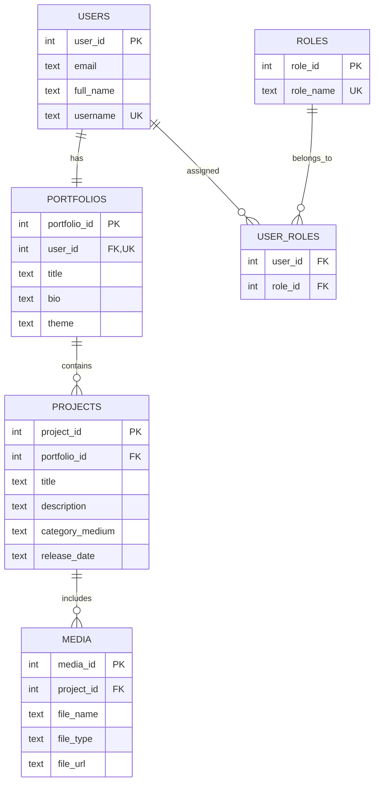

# Data model: Artist Portfolio Platform

> Write this BEFORE you ask an AI to generate a schema, and commit it first.
> Prompt 01 (`prompts/01-interview-me.md`) helps you draft it. You then correct it.
> Everything in [SQUARE BRACKETS] is for you to replace.

## The app in one sentence

Visual artists and audio creators use it to display multi-disciplinary portfolios, organize creative projects, and showcase attached media assets and music tracks.

## Entities (the things the app stores)

| Entity | One row means... |
|---|---|
| `users` | One artist account registered on the platform. |
| `roles` | One predefined artist role or creative discipline (e.g., Musician, Visual Artist). |
| `user_roles` | One assignment linking an artist to a creative role they perform. |
| `portfolios` | One main public portfolio profile belonging to an artist. |
| `projects` | One creative release, album, or project contained within a portfolio. |
| `media` | One audio track, artwork image, or video file attached to a project. |

## Fields

### `users`

| Field | Type | Required? | Rules (constraints) | Example |
|---|---|---|---|---|
| `user_id` | INTEGER | yes | PRIMARY KEY, AUTOINCREMENT | 1 |
| `email` | TEXT | yes | NOT NULL | "alex@example.com" |
| `full_name` | TEXT | yes | NOT NULL | "Alex Rivera" |
| `username` | TEXT | yes | NOT NULL, UNIQUE | "arivera" |

### `roles`

| Field | Type | Required? | Rules (constraints) | Example |
|---|---|---|---|---|
| `role_id` | INTEGER | yes | PRIMARY KEY, AUTOINCREMENT | 1 |
| `role_name` | TEXT | yes | NOT NULL, UNIQUE, CHECK (IN ('Musician', 'Vocalist', 'Visual Artist', 'Graphic Designer', 'Sound Designer', 'Music Producer', 'Audio Engineer', 'Foley Artist')) | "Musician" |

### `user_roles`

| Field | Type | Required? | Rules (constraints) | Example |
|---|---|---|---|---|
| `user_id` | INTEGER | yes | FOREIGN KEY to `users(user_id)` ON DELETE CASCADE | 1 |
| `role_id` | INTEGER | yes | FOREIGN KEY to `roles(role_id)` ON DELETE CASCADE | 1 |

### `portfolios`

| Field | Type | Required? | Rules (constraints) | Example |
|---|---|---|---|---|
| `portfolio_id` | INTEGER | yes | PRIMARY KEY, AUTOINCREMENT | 1 |
| `user_id` | INTEGER | yes | FOREIGN KEY to `users(user_id)` ON DELETE CASCADE, UNIQUE | 1 |
| `title` | TEXT | yes | NOT NULL | "Alex Rivera Soundscapes" |
| `bio` | TEXT | yes | NOT NULL | "Audio producer and multi-instrumentalist." |
| `theme` | TEXT | no | | "dark-mode" |

### `projects`

| Field | Type | Required? | Rules (constraints) | Example |
|---|---|---|---|---|
| `project_id` | INTEGER | yes | PRIMARY KEY, AUTOINCREMENT | 1 |
| `portfolio_id` | INTEGER | yes | FOREIGN KEY to `portfolios(portfolio_id)` ON DELETE RESTRICT | 1 |
| `title` | TEXT | yes | NOT NULL | "Atmospheric Audio Pack" |
| `description` | TEXT | yes | NOT NULL | "A collection of ambient audio tracks." |
| `category_medium` | TEXT | yes | NOT NULL | "Sound Design" |
| `release_date` | TEXT | no | ISO8601 string `YYYY-MM-DD` | "2026-03-15" |

### `media`

| Field | Type | Required? | Rules (constraints) | Example |
|---|---|---|---|---|
| `media_id` | INTEGER | yes | PRIMARY KEY, AUTOINCREMENT | 1 |
| `project_id` | INTEGER | yes | FOREIGN KEY to `projects(project_id)` ON DELETE CASCADE | 1 |
| `file_name` | TEXT | yes | NOT NULL | "Track_01_Forest.mp3" |
| `file_type` | TEXT | yes | NOT NULL, CHECK (IN ('image', 'audio', 'video')) | "audio" |
| `file_url` | TEXT | yes | NOT NULL | "https://storage.example.com/audio/track1.mp3" |

Tip: SQLite has no date type. Store dates as TEXT in the form `YYYY-MM-DD` so they sort and compare correctly.

## Relationships

- One `user` has exactly one `portfolio`. Each `portfolio` belongs to exactly one `user`.
- One `user` can have many `roles` (and one `role` can belong to many `users`) via `user_roles`.
- One `portfolio` has many `projects`. Each `project` belongs to exactly one `portfolio`.
- One `project` has many `media` items. Each `media` item belongs to exactly one `project`.

## The delete rule (my decision, with my reason)

### 1. User → Portfolio Delete Rule

If someone deletes a `user` that still has a `portfolio`:

- [ ] **RESTRICT**: block the delete. The `user` stays until its `portfolio` is dealt with.
- [x] **CASCADE**: delete the `portfolio` too, silently.
- [ ] **SET NULL**: keep the `portfolio` but empty their link (the link column must then allow NULL).

**I chose:** CASCADE

**Because:** Blocking account deletion until sub-records are manually cleared causes onboarding/offboarding friction and raises privacy/GDPR compliance concerns for users requesting account removal.

---

### 2. Portfolio → Project Delete Rule

If someone deletes a `portfolio` that still has `projects`:

- [x] **RESTRICT**: block the delete. The `portfolio` stays until its `projects` are dealt with.
- [ ] **CASCADE**: delete the `projects` too, silently.
- [ ] **SET NULL**: keep the `projects` but empty their link (the link column must then allow NULL).

**I chose:** RESTRICT

**Because:** Automatic cascade deletion could wipe an artist's entire life's body of work in a single accidental click.

---

### 3. Project → Media Delete Rule

If someone deletes a `project` that still has `media` items:

- [ ] **RESTRICT**: block the delete. The `project` stays until its `media` items are dealt with.
- [x] **CASCADE**: delete the `media` items too, silently.
- [ ] **SET NULL**: keep the `media` items but empty their link (the link column must then allow NULL).

**I chose:** CASCADE

**Because:** Requiring manual deletion of every individual audio or image file before removing a project creates unnecessary friction for creators and leaves orphan media files behind.

## Diagram

## What I changed after testing

Fill this in as you go. It is great material for the "design decisions" section of your CA2 write-up.

| Date | What I changed | Why (what testing showed me) |
|---|---|---|
| [DATE] | [CHANGE] | [REASON] |